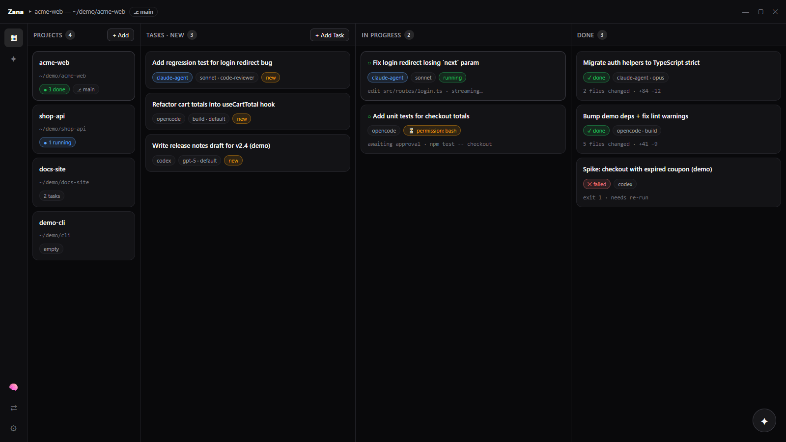
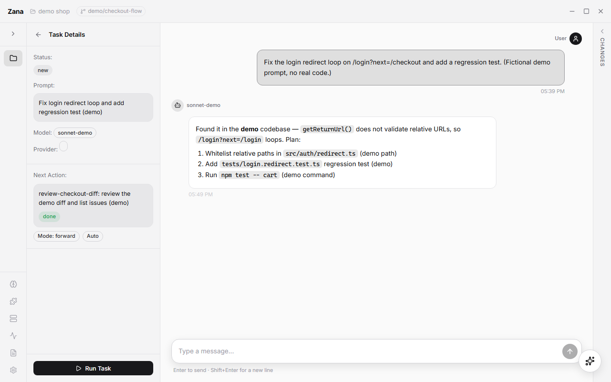
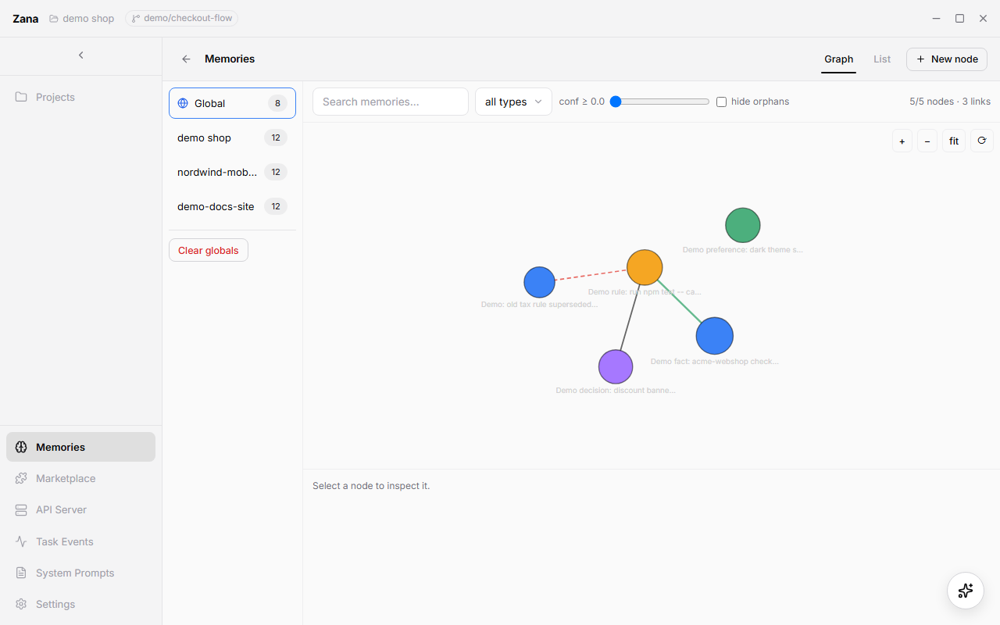
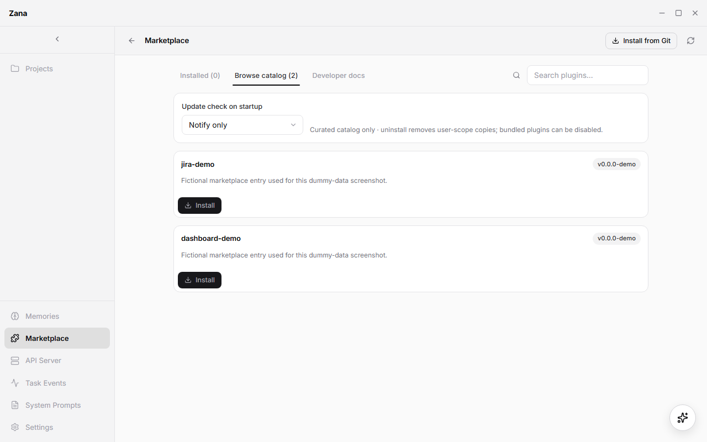
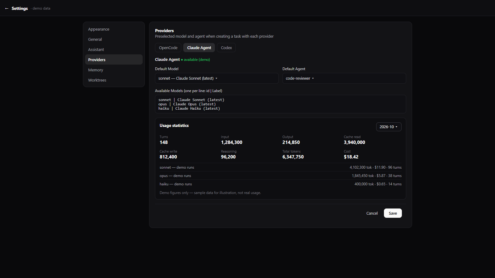

# Zana — Desktop task runner for AI coding work

> **This repo only hosts installers.** Download the latest **`Zana-Setup-X.Y.Z.exe`** from the
> [**Releases page**](https://github.com/albertRrushi/zana_releases/releases), run it, and launch Zana.
> No source code lives here.

Zana is a desktop task runner for AI coding work. Instead of babysitting one chat window in one repo, you define **Projects** (folders on disk) and **Tasks** (prompts to run in those folders), and Zana executes them through your preferred AI backend, tracks their state, chains them together, and lets both you and other agents drive everything via UI or API.

> All screenshots below are mockups with fictional/demo data for illustration — no real projects, code, or usage figures.

## Screenshots (light mode, mock data)

| Projects — task board | Task detail — chat |
|---|---|
|  |  |

| Memories — memory graph | Marketplace — plugin catalog |
|---|---|
|  |  |

| Settings → Providers — Claude Agent defaults |
|---|
|  |

---

## 1. What Zana does

- **Runs coding tasks in the background.** Fire off "fix login bug", "add tests for X", "refactor Y" and keep working. Watch progress in the In Progress panel instead of a blocked terminal.
- **Supports multiple AI providers behind one interface.** OpenCode (chat/SSE), Claude Agent (headless SDK), and Codex. Pick per task; switch defaults in Settings.
- **Chains tasks and actions.** Task A → Task B (`next_action`), with `none` (just run next) or `forward` (pass A's output into B's prompt) modes, plus auto-run and loop counters. Actions run shell commands; triggers/scheduler fire them on schedules or events.
- **Keeps a memory graph — and distills it automatically.** Typed memory nodes (fact/preference/rule/decision/context/episodic) with confidence 0–1, linked by supports/contradicts/refines/supersedes/relates_to — project-scoped plus global, visualized as a graph, searchable by you or an agent. When a task finishes, Zana distills durable lessons out of the transcript into new nodes (see §5) so the next task starts smarter.
- **Is automatable.** A local HTTP API server (loopback only, token-auth) plus a bundled stdio MCP server expose projects, tasks, and memory as tools (`zana_*`, `memory_*`) so agents can create, run, monitor, and retry tasks for you.
- **Shows real repo state.** Built-in git status/diff viewer, worktree support, and file-change events (no polling freezes) so you can review what the agent actually changed.
- **Extends in minutes via plugins + Marketplace.** Dashboards, commands, hooks, actions, triggers, and skills ship as tiny plugins (5 files max) you install from the Marketplace or any git URL — see §6. No fork required.

In short: Zana turns ad-hoc AI chats into **tracked, repeatable, chainable units of work**.

---

## 2. Core concepts

| Concept | What it is |
|---|---|
| **Project** | A named folder on disk (`name`, `path`, optional `alias`). All tasks belong to a project; the AI runs with that folder as its working directory. |
| **Task** | A unit of work: `prompt` + `execution_type` (`opencode` / `claude-agent` / `codex`) + optional `agent` / `model` + status (`new` → `in_progress` → `done` / `failed`). Stores `session_id` and last `output` for chaining. |
| **Session** | The underlying AI conversation. OpenCode sessions stream over SSE; Claude Agent and Codex sessions run headless through their SDKs. |
| **Next action** | Task B (or an Action) that runs when Task A finishes. `next_action_auto=1` runs it automatically; `forward` mode prepends A's output to B's prompt. Loops re-run A with B's output up to `max_loops`. |
| **Action / Trigger** | An Action is a reusable shell command. A Trigger fires actions on a schedule or event. History lives in Action Runs / Fired Triggers lists. |
| **Memory** | Typed nodes + links. `project_id NULL` = global. Listing with a project returns project + global merged. Nodes carry `type`, `confidence` (with reinforce/decay/contradict lifecycle) and optional `expires_at`; `GET /memory/graph` serves nodes + edges for the graph view. |
| **System prompt** | Global prompt text prepended to tasks. Managed in System Prompts view. |
| **Awaiting input** | When a run blocks on a permission (`edit`, `bash`, `webfetch`, etc.) or a `question` tool call, Zana surfaces it as a badge + toast + answer controls. The turn stays suspended until you answer. |

### Task state machine

```
new → in_progress → done
          ↓
        failed
done → in_progress (you send a follow-up message)
```

---

## 3. UI tour

Left sidebar:

- **Projects** (main view), **Chat**, and bottom nav: **Memories**, **API Server**, **Task Events**, **System Prompts**, **Settings**.

### Main view — four columns

1. **Projects** — project list + Add Project (folder picker). Deleting a project optionally migrates its memories to global or hard-deletes them.
2. **Tasks** — tasks for the selected project + Add Task. Shows provider badge, agent/model, status.
3. **In Progress** — running tasks with spinner. Permission/question badges appear here — this is where you see "which task needs me".
4. **Done** — completed/failed tasks. Click any task to open its detail.

### Task detail

Left column: task metadata (prompt, agent, model, status, provider badge), next-action config, loop count, Run/Stop/Reset/Trigger-next buttons, error output panel.

Center column: streaming chat with thinking blocks, code blocks, and a composer. Follow-up messages re-arm a `done` task to `in_progress`.

Right/bottom: git status + diff file explorer ("Send to LLM" routes into the session), permission/question answer controls when `awaiting_input` fires.

### Other views

- **Assistant** — floating overlay (sparkle button, bottom-right; minimize collapses it back) for ad-hoc conversation outside a task.
- **Memories** — Global accordion + one per project, with counts, per-row delete, Clear project memories, Make memories global.
- **System Prompts** — create/edit global system prompts.
- **Settings** — default provider, per-provider defaults (`{agent, model}`), Claude Agent model list editor (one `id | Label` per line), theme (dark/light).
- **Task Events** — status/stream event feed for debugging.
- **API Server** — running/stopped switch, auth token with copy button, static endpoint reference table, and live last-100-requests log (expandable POST bodies).

---

## 4. How to use it — typical workflows

### 4.1 Add a project

1. Go to Projects → **Add Project**.
2. Pick a folder (native folder dialog) and give it a name/alias.
3. Select it in the project list. Its tasks appear in the tasks column.

### 4.2 Create and run a task

1. In the tasks column → **Add Task**.
2. Pick the **provider** (`OpenCode` / `Claude Agent` / `Codex`). The dialog loads that provider's agents/models dynamically. Leave agent/model empty to use your Settings defaults — only set them explicitly if you mean it.
3. Write the **prompt** (e.g. "Fix the login redirect bug and add a regression test").
4. Optionally set **Next action**: another task or an action, mode `none` or `forward`, auto on/off, max loops.
5. Save → task appears as `new` → press **Run** (or run on create).
6. Watch it in In Progress and read the streaming chat.
7. Answer any **permission/question prompts** in the banner above the composer.
8. When it reaches `done`, review the diff in the file explorer, then Reset (clones the chain fresh) or send a follow-up to iterate.

Run/Stop/Reset/Send are also available headlessly via API/MCP (see §8).

### 4.3 Chain tasks (review → fix loops, multi-step plans)

Example: Task A "implement feature" → next action Task B "review the diff and list issues", mode `forward`, loop enabled, `max_loops 3`.

1. A completes → B runs with A's output prepended.
2. B completes → its output is injected back into A's session → A re-runs (`loop_count+1`).
3. Stops after `max_loops` or when you stop/reset it.

Use `forward` when the next step needs the previous answer; `none` for fire-and-forget sequencing. Trigger-next fires the chain manually on demand.

### 4.4 Memories, distillation, and system prompts

**Manual memories:** save durable facts ("repo uses pnpm", "always run `npm test` before marking done") as typed memory nodes with confidence. Link related nodes; reinforce on confirmation, contradict instead of deleting. Agents retrieve them via `memory_search` (keyword + 1-hop expansion, ranked by match, confidence and graph degree).

- Explore project or global memories as a connected graph (node size = confidence, color = type, edge style = relation) with search, type and confidence filters.
- Promote useful project memories to global so every project benefits.
- Put standing instructions in System Prompts rather than repeating them in every task prompt.

**Automatic distillation (the compound-interest part):** when a task reaches `done`, Zana extracts durable, reusable knowledge from the transcript and stores it as new memory nodes — tagged `auto-distilled` so you can tell them apart from hand-written ones. You don't have to remember to write things down.

What gets distilled: stack choices, repo conventions, gotchas, user preferences, and decisions that future tasks in the same project (or globally) should reuse. One-off chatter is skipped; only repeat-value facts become nodes, each with a type, confidence, tags, and links to related nodes.

Lifecycle is the same as manual memories: reinforce what proves true, decay what goes stale, contradict (don't just delete) what turns out wrong, set `expires_at` for time-bound facts. See §5 for controls.

### 4.5 Actions, triggers, scheduler

Create an Action (shell command, e.g. lint/test/build), then a Trigger (cron-like schedule or event) to run it. Check Action Runs and Fired Triggers lists for history.

### 4.6 Assistant and plugin skills

The **Assistant** (sparkle button, bottom-right; minimize collapses it back) operates Zana through tools on your behalf — listing projects, running tasks, searching memory, driving plugin commands. Its tool permissions are always auto-approved; only model questions ask first (except Codex, where the transport runs everything without asking).

Plugins can ship **skills** — extra instructions the assistant loads on demand (e.g. ask it to build a dashboard and it loads the skill and builds the board). Skills from enabled plugins are picked up automatically. Disabling a plugin removes its skills everywhere.

---

## 5. Memory distillation — knowledge that compounds automatically

Memories in Zana are typed nodes + links:

- **Types:** `fact` / `preference` / `rule` / `decision` / `context` / `episodic`.
- **Confidence:** `0–1` (`0` = no longer valid; higher = reinforced, lower = degraded). Graph node size reflects it.
- **Relations:** `supports` / `contradicts` / `refines` / `supersedes` / `relates_to`.
- **Scope:** `project_id NULL` = global. Listing with a project returns project + global merged. `GET /memory/graph` serves nodes + edges for the graph view.

Distillation writes to that same graph, so manual and automatic knowledge share search, UI, and API:

1. Task finishes (`done`) → Zana proposes durable nodes from the transcript.
2. Nodes land project-scoped (promote to global later if they prove generally useful).
3. You review them in **Memories** like any other node — reinforce, adjust confidence, link, contradict, delete, or set `expires_at`.
4. Next task (yours or an agent's via `memory_search` / `memory_store` / `memory_adjustconfidence`) retrieves them automatically.

**Controls:**

- Global default in **Settings**; per-project override in Project settings (gear icon) or at creation time in Add Project. Leaving override off follows the global value, including future changes; turning it on reveals the per-project choice.
- Headless: `distill_enabled: 1` (default) / `0` (opt out) on project create.
- Deleting a project optionally migrates its memories to global or hard-deletes them — distilled knowledge is never silently lost.

> Tip: distillation replaces "remember to update the docs" with "correct the memory once". When Zana gets something slightly wrong, use reinforce/contradict instead of deleting — the link history is what makes the graph smarter over time.

---

## 6. Marketplace & plugins — extend Zana in ~5 files

Plugins add **sidebar dashboards, commands, event hooks, reusable actions, schedules, and assistant skills** — without forking Zana. The Marketplace view is the catalog:

- **Installed tab** — enable/disable; uninstall is user-scope only (bundled plugins say "disable instead").
- **Browse tab** — search, permission preview (exact CLI pins, network hosts, Zana scopes), Install/Update. Update policy `plugins.auto_update`: `off` / `notify` (default) / `auto`.
- **Install sources** — one-click catalog entries (e.g. `jira`, `github`, `devops`), or **Install from Git**: any public `https://…​.git` (or SSH with agent) + optional `ref` (branch/tag/commit) + optional `path` subdir for monorepos. Every install is validated before it lands in `~/.zana/plugins/`; `.git`/`node_modules` are stripped, provenance is kept, and a user copy shadows the bundled one.
- **Trust model:** plugins run fully trusted in the main process — permissions are a consent surface, not a sandbox. Only install plugins you trust; auto-updates run only under opt-in `auto`.

Live examples in this repo's `marketplace.json`: [jira-plugin](https://github.com/albertRrushi/jira-plugin) (dashboard + read-only lookup), [zana_github](https://github.com/albertRrushi/zana_github) (sidebar dashboard + PR/issue/commit/review-queue commands via your own `gh` CLI), [devops-plugin](https://github.com/albertRrushi/devops-plugin) (same shape for Azure DevOps via `az` CLI).

### Build one in minutes (hostApi v0.2)

A plugin is at most 5 files — only `zana/plugin.zana.json` is Zana-specific:

```
my-plugin/
  plugin.json               # identity only (Agent Plugins v1, closed schema)
  zana/plugin.zana.json     # Zana extension: views/commands/hooks/actions/triggers/settings
  zana/main.js              # activate() + data/command methods (~20 lines to start)
  skills/<name>/SKILL.md    # optional, portable agent instructions
  mcp.json                  # optional, portable MCP servers
```

1. **Declare** in `plugin.json`:
```json
{
  "$schema": "https://agent-plugins.org/schemas/1.0.0/plugin.schema.json",
  "name": "my-plugin",
  "version": "0.1.0",
  "description": "One line.",
  "extensions": { "zana": "./zana/plugin.zana.json" }
}
```

2. **Extend** in `zana/plugin.zana.json`:
```json
{
  "$schema": "https://zana.ai/schemas/plugin.zana.v1.json",
  "hostApi": "^0.2",
  "main": "./main.js",
  "activationEvents": ["onView:my-view", "onCommand:my-plugin.sync"],
  "contributes": {
    "views": [{ "id": "my-view", "title": "My View", "slot": "sidebar-bottom", "icon": "Plug" }],
    "commands": [{ "command": "my-plugin.sync", "title": "Sync now" }]
  },
  "permissions": { "network": [], "fs": "none", "zana": ["tasks:read", "notify"] }
}
```

3. **Code** in `zana/main.js`:
```js
async function activate(zana) {
  zana.commands.register('my-plugin.sync', async () => {
    const tasks = await zana.tasks.list();
    zana.notify.toast(`Synced ${tasks.length} tasks`);
    return { ok: true, count: tasks.length };
  });
}
async function myViewData() {
  return {
    title: 'My View',
    sections: [{ title: 'Items', rows: [{ label: 'KEY-1', value: 'Do a thing' }] }],
    actions: [{ label: 'Sync now', command: 'my-plugin.sync' }]
  };
}
module.exports = { activate, myViewData };
```

That's a working sidebar view + palette/API/MCP command. From there add what you need — `hooks` with a tiny `when` grammar (`status == 'failed'`), `actions` (reusable shell steps for chaining), `triggers` (`every 15m` / `at 09:30` / `manual`), `settings`/`secrets`, dashboard views (`getDashboards` / `widgetData` / `saveDashboards` + the 4 `dashboard-get` / `widget-catalog` / `widget-preview` / `dashboard-save` commands agents navigate by), and `skills/` so the Assistant picks up your workflow automatically.

Host guarantees that keep plugins safe to write: lazy activation (your code loads only when its view/command/event fires), 5s budget per call (failures log to Task Events, never crash the host), strict validation (`node scripts/validate-plugin.js ./my-plugin` → `PASS`/`FAIL` with fix hints), pinned CLI spawning (`proc.exec` with allowlisted binaries, no shells), and per-plugin `kv` + `secrets` storage.

Reference to copy from: the [jira-plugin](https://github.com/albertRrushi/jira-plugin) repo — dashboard view + commands + settings + skill + icon + templates. Ask Zana's Assistant to scaffold from it ("build a plugin that…") and it loads the built-in `zana-plugin-builder` skill and writes the files for you.

---

## 7. Providers at a glance

|  | OpenCode | Claude Agent | Codex |
|---|---|---|---|
| UI | Streaming chat bubbles | Streaming chat | Streaming chat |
| Session | SDK session with streaming events | Headless Agent SDK session | SDK session |
| Permissions | Surfaced in Zana banner (approve/deny) | Surfaced in Zana banner | Surfaced in Zana banner |
| Best for | Supervised runs you want to watch as chat | Claude subscription runs without a terminal | Alternate model/policy runs |

`POST /tasks` resolves missing `execution_type`/`agent`/`model` from settings, so callers normally omit them.

---

## 8. Automating Zana — API server + MCP

The app embeds an HTTP API on port `4097` (loopback-only by default, opt-in network exposure, persistent per-app Bearer tokens generated in the **API Server** view and passed as `ZANA_TOKEN` to the MCP server). Toggle it and inspect live requests in the **API Server** view.

| Method | Path | Purpose |
|---|---|---|
| `GET` | `/health` | Health check |
| `GET` / `POST` | `/projects`, `/tasks?project=<id>`, `/tasks/:id` | List/get/create projects and tasks |
| `POST` | `/tasks/:id/run`, `/stop`, `/reset`, `/send {text}`, `/next` | Task lifecycle |
| `GET` / `POST` / `PUT` / `DELETE` | `/memory`, `/memory/graph`, `/memory/:id`, `/memory/store`, `/memory/search`, `/memory/:id/links`, `/memory/:id/adjust`, `/memory/:id/reinforce`, `/memory/:id/contradict` | Memory graph |

The bundled stdio MCP server wraps these as tools (`zana_status`, `zana_list_projects`, `zana_create_project`, `zana_list_tasks`, `zana_get_task`, `zana_create_task`, `zana_run_task`, `zana_stop_task`, `zana_reset_task`, `zana_send_message`, `zana_trigger_next`, `memory_store`, `memory_search`, `memory_adjustconfidence`, plus `list_skills`, `get_skill`, `zana_install_skills`, `zana_install_agents`). Install it user-wide in your agent host — see the **API Server → Setup** tab for copy-ready commands (e.g. `claude mcp add zana --scope user --env ZANA_TOKEN=<token> -- node "<install-dir>\ZanaMCP\index.js"`, `codex mcp add zana --env ZANA_TOKEN=<token> -- node "<install-dir>\ZanaMCP\index.js"`, or the global `~/.config/opencode/opencode.json` block for OpenCode; replace `<token>` with an app token from the API Server view and `<install-dir>` with your install folder) — then an agent can monitor `in_progress`/`failed` tasks, diagnose via `zana_get_task`, retry transient failures, chain related tasks, and resolve projects before creating tasks.

The server also advertises its bundled skills over MCP — discover via the `list_skills` tool, fetch instructions with `get_skill`. On startup the skills are automatically installed into the standard host directories (`~/.claude/skills`, `~/.config/opencode/skills`, `~/.codex/skills`, `~/.agents/skills`), so hosts with native Agent Skills support pick them up with no manual copy; call `zana_install_skills` to repair the install.

The monitor and distiller playbooks ship as native agents instead — Claude `~/.claude/agents/*.md`, OpenCode `~/.config/opencode/agents/*.md`, Codex `~/.codex/agents/*.toml` — installed on startup and every app launch; call `zana_install_agents` to repair the install.

The Windows installer offers an **Include MCP server** checkbox (on by default): when checked, the MCP server files (dependencies pre-installed) are copied to `<install-dir>\ZanaMCP` and a ready-to-use host config is written next to it as `mcp.installed.json` (with a `ZANA_TOKEN` placeholder to replace with an app token from the API Server view). Project-local `.mcp.json` installs are not recommended. Unchecking skips the copy; uninstall removes the folder.

---

## 9. Why this approach works

1. **One inbox for all AI work.** Parallel tasks across repos are visible as rows with states, not lost across terminal windows. You (or an agent) always know what is running, blocked, or done.
2. **Provider-agnostic without lowest-common-denominator UX.** The abstraction is at the execution layer, with every provider streaming into the same chat experience.
3. **Turns chats into repeatable pipelines.** Next-action chaining with forward/loop modes encodes "implement → review → fix" once and reuses it, instead of copy-pasting outputs between sessions.
4. **Human attention is routed, not polled.** Permission/question events, toasts, badges, and deep-links mean you only look when a task genuinely needs you.
5. **Reviewable by construction.** Git status/diff is next to the transcript, and every run leaves status + output + history behind.
6. **Local-first and scriptable.** Local database in the main process, loopback-only API with per-app tokens, MCP tools for agents, actions/triggers/scheduler for automation — the same backend serves clicks, cron, and LLM drivers.
7. **Knowledge compounds.** Project + global memories and system prompts persist what works, so each task starts smarter than the last.

---

## 10. Tips and troubleshooting

- **Marketplace install fails validation** → run `node scripts/validate-plugin.js ./my-plugin` in the Zana app repo; common fixes: command prefix must equal plugin name (`my-plugin.*`), every `onView:`/`onCommand:` must reference a declared contribution, `main` is required when commands/hooks exist.
- **MCP says "Zana app is not running"** → launch Zana and check the API Server view is started.
- **Provider/model dropdown stale** → Settings → Provider Defaults; stale values render instead of blanking so you can correct them.
- **Second launch does nothing** → single-instance lock: it focuses the running window instead of fighting over ports/DB. That's intentional.
